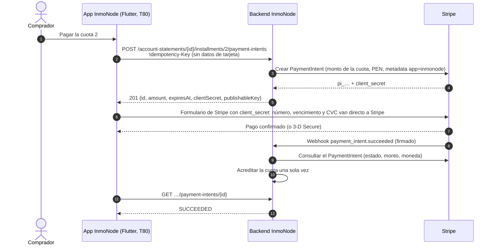

# T78 · Pasarela de pagos para el cobro de cuotas

- **Historia:** US-48, spike de la integración de la pasarela de pagos web.
- **Responsables:** Breithner Perez; colabora Angel Rocca.
- **Fecha:** evaluación el 2026-11-22. Este documento es del 2026-11-25.
- **Estado:** decisión aplicada en T79 (PR #38, US-55) y probada en Render en T92.

## Contexto

US-48 pide documentar una arquitectura para cobrar cuotas con tarjeta de forma segura:

- **Escenario 1:** un diagrama en el que los datos de la tarjeta viajen del cliente al proveedor sin pasar por el backend (tokenización).
- **Escenario 2:** el diseño del endpoint que recibe los eventos de pago (webhooks).

El Product Backlog nombraba a Culqi.

## Qué se evaluó

| Proveedor | Resultado | Motivo |
|---|---|---|
| Culqi | Descartado | Abrir la cuenta pide demasiados datos personales para un proyecto académico |
| Hyperswitch | Descartado | No se pudo completar el registro |
| **Stripe, modo de prueba** | **Elegido** | Ya había una cuenta en modo de prueba. Tiene SDK web y móvil para los campos de la tarjeta y webhooks firmados |

En Stripe se comprobó lo siguiente el 2026-11-22:

- **Cobros en soles:** acepta PEN con un mínimo de unos USD 0,50. Rechazó S/ 1 y aceptó S/ 5.
- **Webhooks:** la Stripe CLI (`stripe listen`) reenvió eventos `payment_intent.*` a un receptor local, y su cabecera `Stripe-Signature` se validó con el secreto de firma.
- **Moneda y monto:** el PaymentIntent guarda el monto en céntimos y la moneda en minúsculas (`pen`). El backend los compara con la cuota antes de acreditar.

### Limitación para producción real

Stripe no abre cuentas a empresas con sede en Perú. En Latinoamérica, [su lista de países](https://stripe.com/global) solo incluye a Brasil y México. El modo de prueba basta para el proyecto, pero una inmobiliaria peruana tendría dos opciones:

- operar con una empresa constituida en un país admitido; o
- cambiar a un adquirente local (Culqi, Niubiz o Izipay).

El diseño ya deja abierto el cambio:
- el backend solo habla con Stripe a través de los puertos `PaymentGateway` y `PaymentGatewayWebhookVerifier`;
- la cuota guarda `payment_source = GATEWAY`, sin nombrar al proveedor.

Cambiar de proveedor sería un adaptador nuevo y su webhook, sin tocar el dominio.

### Entorno de prueba compartido

Las llaves son del entorno de prueba de otro proyecto del equipo (MindFlow), porque Stripe no deja crear otro entorno sin verificar la empresa. Para no mezclar cobros:

- InmoNode cobra solo con **PaymentIntents**, nunca con Checkout Sessions, que es lo que escucha MindFlow;
- todo lo que crea lleva `metadata[app]=inmonode`, y el webhook ignora lo que no lo tenga;
- tiene su propio destino de webhook ("InmoNode Webhook"), con solo los tres eventos `payment_intent.*`.

## Escenario 1: la tarjeta no pasa por el backend

- **El backend nunca ve la tarjeta.** El backend solo recibe el número de cuota y fija el monto. Los campos de la tarjeta los sirve Stripe: un iframe en la web y el SDK nativo en Android. El backend no guarda, procesa ni transmite datos de tarjeta, y así el alcance de PCI-DSS queda en lo mínimo.
- **El cliente nunca marca la cuota como pagada.** Solo el webhook confirmado la acredita, y el `GET` solo informa.
- **Idempotencia:**
  - la misma `Idempotency-Key` devuelve el mismo cobro;
  - hacia Stripe se envía `inmonode-intent-{id}`, para que un reintento del backend no cree dos PaymentIntents.
- **Vencimiento:** el cobro vence a los 30 minutos (`PAYMENT_INTENT_TTL`). Antes de reabrir uno vencido, se consulta en Stripe: si ya se cobró, se acredita.

## Escenario 2: el receptor de webhooks

`POST /api/v1/webhooks/stripe` es público, y lo autentica la firma:

| Aspecto | Diseño |
|---|---|
| Autenticación | `Stripe-Signature` (HMAC-SHA256 con `STRIPE_WEBHOOK_SECRET`), con 5 minutos de tolerancia |
| Eventos | `payment_intent.succeeded`, `payment_intent.payment_failed` y `payment_intent.canceled` |
| Correlación | Por el id del PaymentIntent. Si el evento llega antes de que se guarde ese id, se usa `metadata.installmentPaymentIntentId` |
| Confirmación | Con `succeeded` no se confía en el cuerpo: se consulta el PaymentIntent en Stripe y se comparan estado, monto y moneda con la cuota |
| Idempotencia | Cada evento se registra en `payment_gateway_events` por su id. Un reenvío responde lo que se registró la primera vez (`DUPLICATE`) |
| Concurrencia | Se bloquean el lote, luego el estado de cuenta y luego el cobro. El resultado se registra en la misma transacción que acredita (corrección de T91) |
| Cobro que ya no cuadra | Si la cuota se pagó por otro medio o cambió su mora, el cobro queda `UNAPPLIED` y se avisa a finanzas para devolverlo |

**Respuestas:**
- **400 `INVALID_WEBHOOK_SIGNATURE`:** firma inválida, vencida o ausente.
- **200:** todo evento verificado, también el que se ignora, para que Stripe no lo reintente. Lleva el resultado: `CREDITED`, `DUPLICATE`, `UNAPPLIED`, `IGNORED`, `FAILED` o `CANCELED`.
- **500:** si falla la base, Stripe reintenta.
- **503 `PAYMENTS_UNAVAILABLE`:** sin llaves configuradas, el resto del sistema funciona igual.

## Evidencia

- **T79 (PR #38):**
  - pruebas unitarias y de integración del cobro y del webhook, con firmas reales y Stripe simulado;
  - recorrido local con Docker Compose y `stripe listen`: 14 de 14.
- **T91 (PR #40):** un mismo evento entregado 4 veces a la vez, y el webhook compitiendo con el pago en oficina. La cuota se acredita una sola vez.
- **T92, en Render, el 2026-11-25** (comprobaciones 33 a 39 de su evidencia):
  - sin firma: 400;
  - un evento firmado de otro cobro: 200 `IGNORED`;
  - el pago real de la cuota 2 con la tarjeta de prueba: 200 `CREDITED`, y el estado de cuenta bajó en S/ 3 188,23.

## Pendiente

- **Llave restringida:** usar en Render una llave `rk_test_…` con escritura solo en PaymentIntents, en lugar de la llave secreta completa, como recomienda Stripe.
- **Pago desde la app:** la pantalla de pago es T80, en Flutter.

## Fuentes

- Stripe, países admitidos: https://stripe.com/global (consultado el 2026-11-25)
